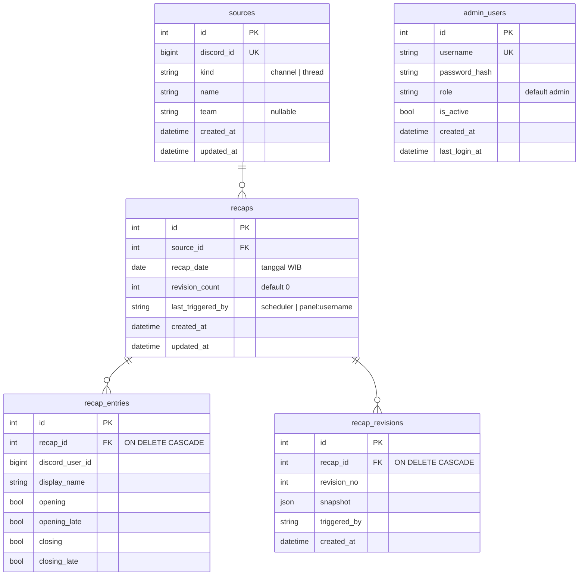

# Progres: Database + Login Admin

Branch: `feature/database-login` (belum di-merge ke `master`)
Terakhir diperbarui: 2026-11-15

## Ringkasan status

**Semua langkah (0–10) selesai.** Tinggal commit Langkah 10, lalu ikuti [Checklist sebelum merge](#checklist-sebelum-merge).

| Langkah | Isi | Status | Commit |
|---|---|---|---|
| 0 | Analisis kode, ERD, keputusan desain | ✅ Selesai | — |
| 1 | Config & secrets (`.env`, file example, `.gitignore`) | ✅ Selesai | `2f8c694` |
| 2 | Perbaikan bug tengah malam di scheduler + test | ✅ Selesai | `06fa085` |
| 3 | Layer database: engine, model, migrasi awal Alembic | ✅ Selesai | `951815f` |
| 4 | Service simpan/rewrite + log revisi + cek identik + test | ✅ Selesai | `d2a69f8` |
| 5 | Integrasi ke alur rekap (scheduler & panel) | ✅ Selesai | `aec090e` |
| 6 | Login admin (CLI, login/logout, CSRF, rate limit, proteksi route) | ✅ Selesai | `d51142c` |
| 7 | Halaman riwayat + export Excel dari DB | ✅ Selesai | `b117ab0` |
| 8 | CLI pemetaan source → tim | ✅ Selesai | `232375d` |
| 9 | Skrip backup `scripts/backup_db.py` + cara restore | ✅ Selesai | `25b4649` |
| 10 | Update `bot.http` dan README | ✅ Selesai | (belum di-commit) |

PR: #6 (Langkah 1–4 sudah direview).

Test saat ini: **209 passed, 1 skipped** (symlink tidak didukung di Windows tanpa hak khusus) (`venv\Scripts\python -m pytest`).

---

## Keputusan desain (final)

1. **Database**: SQLite (WAL, foreign keys ON) lewat SQLAlchemy 2.x, migrasi dengan Alembic. Pindah ke PostgreSQL cukup ganti `DATABASE_URL`.
2. **Unit rekap = (source, tanggal WIB)**. Opening & Closing ada dalam satu baris (4 flag), jadi tidak ada `recap_type`. Kunci: `UNIQUE(source_id, recap_date)`.
3. **Rewrite**: rekap ulang tanggal yang sama menimpa data. Versi lama disimpan ke `recap_revisions`.
4. **Hasil identik**: hanya `updated_at` dan `last_triggered_by` yang diperbarui, tanpa revisi. Dibandingkan per `discord_user_id`, urutan tidak berpengaruh.
5. **Tanggal tanpa pesan** tetap disimpan dengan 0 entries, supaya rekap ulang bisa mengosongkan data.
6. **Tanggal setelah hari ini (WIB)** tidak disimpan ke DB (status `skipped`), tapi Excel tetap dikirim.
7. **Kalau DB gagal**: error di-log, status `error` per tanggal, dan Excel tetap dikirim ke Discord.
8. **Rentang tanggal**: disimpan per tanggal, masing-masing dalam transaksinya sendiri.
9. **`_collect_range`** memakai Discord user id (`uid`) sebagai kunci dict per hari, dengan nama hasil `resolve_name` di field `"name"`. Dua user dengan nama sama tidak lagi tergabung. Filter, flag, dan isi/format Excel tidak berubah (dibuktikan dengan test pembanding terhadap kode lama). *(Diubah dari rencana awal "hanya tambah field uid".)*
10. **`generate_recap`** dipecah menjadi `_collect_range` + `_write_xlsx`. `run_all_recaps` mengembalikan `(results, save_report)`.
11. **Excel ke Discord** tetap dari data live. Export dari DB hanya untuk halaman riwayat.
12. **Panel** hanya di localhost (`WEB_HOST=127.0.0.1`), tanpa nginx/domain/HTTPS. Static dipindah ke `/static/` supaya semua halaman wajib login.
13. **Zona waktu**: tetap `pytz` dan `TZ` dari `config.py`.
14. **Secret** hanya di `.env`. `appsettings.json` dan `user.json` tidak lagi di-track git (repo public).
15. **Backup**: skrip manual, penjadwalan ditunda sampai deploy.
16. Kolom `opening_at` / `closing_at` ditunda.
17. **Perubahan `display_name` saja** (flag sama) tidak dihitung sebagai perubahan: nama diperbarui, status `unchanged` dengan `names_updated: N`, tanpa revisi. Snapshot revisi lama tetap menyimpan nama saat itu.
18. **User yang dihapus dari `user.json`** lalu tanggal lamanya direkap ulang → entri orang itu hilang dari tanggal tersebut. Ini dihitung sebagai perubahan, jadi versi lama tersimpan di revisi.
19. **Waktu di panel dan export** selalu WIB dengan label "WIB" (DB tetap UTC).
20. **Rentang filter/export** maksimal 366 hari (inklusif). Tanpa tanggal → 30 hari terakhir. Satu tanggal saja → dianggap satu hari itu.
21. **Session**: `session.clear()` sebelum `login_user()` (cegah session fixation). `SESSION_LIFETIME_MINUTES` kosong = sampai browser ditutup; diisi = session permanen, habis setelah N menit tanpa request.
22. **Tim** dibatasi ke `Produk` / `Implementor` / `Development` (case-insensitive, disimpan dengan kapitalisasi baku). `set-team` hanya untuk ID di `channel_ids` / `thread_ids`. Dropdown tim di panel selalu menampilkan ketiga tim.
23. **Backup**: `scripts/backup_db.py` (backup API SQLite, nama bertimestamp WIB, integrity_check, retensi 14 hari berdasarkan timestamp di nama file). **Restore** lewat skrip `scripts/restore_db.py` (bukan langkah manual) karena urutannya krusial: salinan pre-restore dulu, `-wal`/`-shm` lama dihapus sebelum file DB diganti.

### ERD



---

## Yang sudah dikerjakan

### Langkah 1 — Config & secrets (`2f8c694`)

- `config.py` membaca `.env` lewat python-dotenv: `DISCORD_TOKEN`, `SECRET_KEY`, `WEB_HOST` (default `127.0.0.1`), `WEB_PORT` (default `8080`), `SESSION_COOKIE_SECURE` (default `false`), `DATABASE_URL`.
- `bot_token` di `appsettings.json` masih dibaca sebagai fallback sementara.
- File config dicari dari folder proyek, bukan dari folder tempat perintah dijalankan.
- `bot.py` berjalan di `WEB_HOST:WEB_PORT` dan berhenti dengan pesan jelas kalau token kosong.
- `appsettings.json` dan `user.json` dikeluarkan dari tracking git (`git rm --cached`). File lokal tetap ada.
- File baru: `.env.example`, `appsettings.example.json`, `user.example.json`.
- `.gitignore` ditambah: `.env`, `appsettings.json`, `user.json`, `*.db*`, `*.sqlite*`, `backups/`.

### Langkah 2 — Bug tengah malam di scheduler (`06fa085`)

- Bug: tanggal rekap diambil dengan `datetime.now(TZ).date()` **setelah** sleep. Kalau bot bangun lewat 00:00, yang direkap adalah hari baru yang masih kosong.
- Perbaikan: tanggal rekap = `target.date()`, dikunci **sebelum** sleep.
- Perhitungan jadwal dipindah ke fungsi `next_recap_target()` supaya bisa dites, dan tetap benar walaupun jam server UTC.
- Loop mengingat tanggal rekap terakhir, jadi tanggal yang sama tidak direkap dua kali.
- Test (`tests/test_scheduler.py`, 11 kasus): 23:58–00:01 WIB, pergantian tahun, jam server UTC, bangun terlambat 61 detik / 2 menit. Sudah dibuktikan bahwa test ini gagal kalau kode lama dipasang lagi.
- Tambahan: `pytest.ini`, `requirements-dev.txt`.
- Belum berubah: kalau bot mati pada pukul 23:59, rekap hari itu tidak dijalankan susulan secara otomatis. Bisa dijalankan ulang dari panel.

### Langkah 3 — Layer database (`951815f`)

- `db/base.py`:
  - satu engine untuk seluruh proses, `session_scope(write=...)` untuk transaksi singkat,
  - SQLite: WAL, `foreign_keys=ON`, `busy_timeout=5000`, `synchronous=NORMAL`, dan `BEGIN IMMEDIATE` untuk transaksi tulis,
  - semua timestamp disimpan dalam UTC (`utcnow()`).
- `db/models.py`: 5 tabel sesuai ERD, ditambah `UNIQUE(recap_id, revision_no)`, index `recap_date`, dan nama constraint yang eksplisit.
- Alembic: `alembic.ini`, `migrations/env.py` (URL dari `DATABASE_URL`, batch mode SQLite), migrasi `0001_initial_schema.py`.
- `admin_users` sudah ikut di migrasi awal. Langkah 6 tidak perlu migrasi baru.
- Test (`tests/test_db.py`, 9 kasus): skema migrasi sama dengan model, pragma aktif, path relatif, UNIQUE, foreign key, `ON DELETE CASCADE`, JSON roundtrip, `BEGIN IMMEDIATE`.
- Sudah dicek juga: `upgrade` → `downgrade` → `upgrade` berjalan bersih, `alembic check` tanpa perbedaan, dan SQL PostgreSQL menghasilkan `BOOLEAN DEFAULT true` + `JSONB`.

### Langkah 4 — Service simpan/rewrite (`d2a69f8`)

- `services/recap_store.py` (sinkron; di Langkah 5 dipanggil lewat `asyncio.to_thread`):
  - `save_recap_day(source, recap_date, entries, triggered_by, today)` — satu transaksi `BEGIN IMMEDIATE`:
    1. upsert `sources` (nama/kind diperbarui kalau berubah),
    2. belum ada → `created`,
    3. flag identik → `unchanged` (hanya nama, `updated_at`, `last_triggered_by` yang diperbarui),
    4. berbeda → snapshot ke `recap_revisions`, ganti entries, `revision_count` naik → `updated`,
    5. tanggal > hari ini (WIB) → `skipped`, tanpa menyentuh DB.
  - `save_recap_range(...)` — per tanggal, transaksi sendiri. Tanggal tanpa data → 0 entries. Error → `error` + `log.exception`, tanggal lain tetap disimpan.
  - `entries_from_day_data()` — konversi hasil `_collect_range` (dengan field `uid`) ke `EntryIn`.
  - `SourceInfo` / `EntryIn` / `DaySaveResult` (punya `to_dict()` untuk response JSON). Service tidak bergantung pada objek discord.py.
  - Snapshot: `{revision_count, triggered_by, updated_at, entries[]}` dari versi lama. `discord_user_id` di snapshot disimpan sebagai **string** (ID Discord > 2^53, aman dibaca JavaScript di panel).
- Perbaikan `migrations/env.py`: `fileConfig(..., disable_existing_loggers=False)`. Sebelumnya, menjalankan migrasi dari dalam proses mematikan logger aplikasi, sehingga log error hilang.
- Test (`tests/test_recap_store.py`, 17 kasus): simpan pertama, rewrite + snapshot, revisi berulang, rekap identik (urutan beda), perubahan nama saja, nama source berubah, tanggal kosong, mengosongkan data lama, tanggal masa depan, hari ini, rentang tanggal (termasuk kosong & masa depan), rentang campuran, error satu tanggal, `uid` wajib, `uid` duplikat, dua penyimpanan bersamaan.
- Sudah dibuktikan: tanpa `BEGIN IMMEDIATE`, test dua penyimpanan bersamaan gagal 4 dari 6 kali; dengan `BEGIN IMMEDIATE` selalu lolos.

### Langkah 5 — Integrasi ke alur rekap (`aec090e`)

- `services/recap.py`:
  - `_collect_range` → `{date: {uid: {"name", "op", "cl", "op_late", "cl_late"}}}`. Logika filter dan flag tidak berubah.
  - `_write_xlsx(source_name, daily, date_from, date_to)` — urut per nama (lalu uid kalau nama sama). Format, kolom, nama file, dan nama sheet sama seperti sebelumnya.
  - `generate_recap()` tetap ada (kumpulkan + tulis xlsx, tanpa DB).
  - `run_all_recaps(client, date_from, date_to, triggered_by="panel")` → `(results, save_report)`. Per source: kumpulkan → simpan ke DB lewat `asyncio.to_thread(save_recap_range, ...)` → tulis xlsx. Semua source tetap paralel.
  - Kalau DB gagal: `log.exception`, status `error` untuk setiap tanggal source itu, dan Excel tetap dibuat dan dikirim.
- `services/recap_store.py`: `entries_from_day_data` mengikuti struktur baru (kunci uid, `name` wajib).
- `services/scheduler.py`: `triggered_by="scheduler"`, ringkasan hasil simpan dicetak ke log.
- `web/server.py`: response `POST /recap` sekarang berisi `"saved"` (lihat contoh di bawah). `triggered_by` sementara `"panel"`, menjadi `"panel:<username>"` di Langkah 6.
- `web/static/script.js`: hasil simpan per tanggal ditampilkan di log panel. `addLog` sekarang meng-escape HTML (nama thread Discord bisa berisi karakter apa saja).
- Data asli (2 Discord ID + nama karyawan) di `tests/test_recap_store.py` diganti dengan data fiktif.
- Test baru:
  - `tests/test_recap_flow.py` (10): kunci uid + field name, dua uid dengan nama sama (dua entry dan dua baris Excel), **Excel identik dengan kode lama** (salinan persis kode `d2a69f8`, dibandingkan sel per sel untuk 1 hari, rentang, tanpa data, dan file all_channel), `run_all_recaps` menyimpan ke DB, rekap ulang → `unchanged`, DB gagal → Excel tetap ada, tanpa source, simpan DB jalan di thread lain (bukan event loop).
  - `tests/test_server_recap.py` (3): response berisi `saved`, tanpa source, validasi tanggal tetap sama.
  - `tests/test_recap_store.py` (+2): `name` wajib, dua uid dengan nama sama disimpan sebagai dua entry.
- Sudah dibuktikan: kalau urutan baris di `_write_xlsx` diubah, 3 test pembanding Excel gagal.

Contoh response `POST /recap`:

```json
{
  "status": "ok",
  "date_from": "2026-11-12",
  "date_to": "2026-11-12",
  "files": ["recap_2026-11-12_channel_a.xlsx", "recap_2026-11-12_all_channel.xlsx"],
  "saved": [
    {
      "source_id": "800000000000000001",
      "source": "channel a",
      "kind": "channel",
      "dates": [
        {"recap_date": "2026-11-12", "status": "updated", "recap_id": 3,
         "revision_no": 1, "names_updated": 0, "error": null}
      ]
    }
  ]
}
```

### Langkah 6 — Login admin (`d51142c`)

- Sebelum mulai: baris `all_ids` di `services/recap.py` yang tergabung di Langkah 5 dirapikan kembali menjadi dua baris.
- `web/auth.py`:
  - **Guard global** (`before_app_request`): semua request wajib login, kecuali `PUBLIC_ENDPOINTS` (`/login`, `/api/csrf-token`, `/healthz`) dan `PUBLIC_ASSETS` (`style.css`, `logo.jpg`, dipakai halaman login). Route baru otomatis ikut terlindungi.
  - Belum login: navigasi halaman (GET selain `/api/`, `/static/`, `/recap`) → redirect `/login?next=...`; API, asset, dan semua POST → **401 JSON** `{"status": "error", "message": "Belum login."}`.
  - Guard didaftarkan **sebelum** CSRFProtect, jadi request tanpa login dapat 401, bukan 400 CSRF.
  - Login: hash `werkzeug` (scrypt). Username yang tidak ada tetap dicek ke hash dummy supaya waktu respons tidak membocorkan username yang terdaftar. User nonaktif ditolak dan session lamanya ikut tidak berlaku. `last_login_at` dicatat.
  - `next` hanya menerima path lokal (mencegah open redirect).
  - Logout: `POST /logout` (wajib CSRF), `GET` → 405.
  - CSRF: Flask-WTF `CSRFProtect` untuk semua POST. Form login memakai hidden field. `script.js` mengambil token dari `GET /api/me` dan mengirimnya lewat header `X-CSRFToken`. `WTF_CSRF_TIME_LIMIT=None`: token berlaku selama session, supaya panel yang dibiarkan terbuka lama tetap bisa dipakai.
  - Rate limit: Flask-Limiter (memory), `LOGIN_RATE_LIMIT` (default `5 per minute` per IP), **hanya percobaan gagal yang dihitung**. Lewat batas → 429 dengan pesan di halaman login.
  - Cookie session: HttpOnly, SameSite=Lax, Secure mengikuti `SESSION_COOKIE_SECURE`.
  - CLI: `flask --app web.server create-admin` (prompt username + password dengan konfirmasi). Validasi: username 3–64 karakter `[A-Za-z0-9_.-]`, password minimal 8, username unik.
- `web/server.py`: `static_folder=None` + route `/static/<path>` (ikut guard), `GET /healthz` publik, `triggered_by="panel:<username>"` (TODO dihapus).
- `web/templates/login.html` + CSS login di `style.css`. `index.html`: semua asset ke `/static/...`, nama user + tombol LOGOUT di header.
- `bot.py`: berhenti dengan pesan jelas kalau `SECRET_KEY` kosong.
- `config.py` / `.env.example`: `LOGIN_RATE_LIMIT`.
- Dependency baru: `Flask-Login` 0.6.3, `Flask-WTF` 1.3.0, `Flask-Limiter` 4.1.1.
- Test:
  - `tests/test_auth.py` (44): redirect halaman tanpa login (termasuk `next`), 401 JSON untuk API/asset/POST, route publik, path traversal, login benar (session, `last_login_at`, flag cookie), login salah/username tidak ada/password kosong, user nonaktif (login dan session lama), `next` lokal saja, password tersimpan sebagai hash, escape username di halaman login, rate limit setelah 5 gagal, login sukses tidak dihitung, CSRF ditolak (login, `/recap` tanpa token/token palsu, logout), logout, logout wajib POST, validasi `create_admin`, CLI `create-admin`.
  - `tests/test_server_recap.py` diperbarui: wajib login + header CSRF, `triggered_by == "panel:admin"`.
  - Fixture bersama di `tests/conftest.py`: `app`, `client`, `admin`, `auth_client`, `do_login()`, `get_csrf()`.
- Sudah dibuktikan: kalau CSRFProtect didaftarkan sebelum guard login, 2 test "tanpa login → 401" gagal. CLI sungguhan sudah dicoba dengan DB sementara.
- Catatan Windows: prompt password CLI membaca langsung dari konsol, jadi tidak bisa diisi lewat pipe. Saat diketik manual berjalan normal.

### Langkah 7 — Halaman riwayat + export (`b117ab0`)

Tambahan dari review Langkah 6:
- `web/auth.py`: `session.clear()` sebelum `login_user()` (cegah session fixation; token CSRF lama ikut dibuang). Login gagal tidak menghapus session.
- `SESSION_LIFETIME_MINUTES` (`config.py`, `.env.example`): kosong = sampai browser ditutup; diisi = session permanen dengan `PERMANENT_SESSION_LIFETIME` N menit (diperbarui setiap request, jadi habis setelah N menit tidak aktif). Nilai selain bilangan bulat > 0 → bot berhenti dengan pesan jelas.

Riwayat + export:
- `services/recap_query.py` (sisi baca):
  - `parse_filter()` — `date_from`, `date_to`, `source_id`, `team` (`__none__` = tanpa tim). Default 30 hari terakhir, maksimal 366 hari, error → `FilterError` (400).
  - `list_recaps()` — pagination (`page`, `per_page` default 25, maks 100), urut tanggal terbaru lalu nama source. Per baris: source + tim, jumlah entri, `revision_count`, `last_triggered_by`, `created_at`/`updated_at` (WIB).
  - `get_recap_detail()` — data sekarang + setiap revisi (terbaru dulu): siapa/kapan mengganti, versi lama (`old_triggered_by`, `old_updated_at` dalam WIB, `old_entries`), dan `diff_vs_current` per user (`same` / `changed` / `added` / `removed`).
  - `export_xlsx()` — dibuat di memori (BytesIO). Sheet **Recap**: kolom sama persis dengan Excel Discord (`date, source, user, opening, opening_late, closing, closing_late`), urut tanggal → source → nama → uid. Sheet **Info**: waktu export (WIB), filter, dan metadata tiap rekap (tim, jumlah entri, revisi, terakhir oleh, updated_at WIB). Nama file `recap_<tanggal>[_to_<tanggal>]_db.xlsx`.
  - `to_wib()` — UTC naive → `YYYY-MM-DD HH:MM:SS WIB`.
- `web/history.py` (blueprint `/api`, otomatis wajib login lewat guard): `GET /api/sources`, `GET /api/recaps`, `GET /api/recaps/<id>`, `GET /api/recaps/export`.
- Panel: kartu **02 RIWAYAT REKAP** di home, halaman riwayat (filter tanggal/rentang/source/tim, tombol CARI dan EXPORT EXCEL, tabel + pagination, panel detail dengan tabel data sekarang dan diff per revisi). Semua isi dari server dimasukkan lewat `textContent` (bukan `innerHTML`). Tabel bisa di-scroll horizontal di layar kecil.
- Test:
  - `tests/test_history.py` (36): 401 tanpa login untuk semua route baru, konversi WIB (termasuk lewat tengah malam), filter default/satu tanggal/invalid/batas 366 hari, daftar + metadata WIB, filter tanggal/source/tim/tanpa tim, pagination, batas `per_page`, parameter salah → 400, daftar source + tim, detail + diff revisi, detail tanpa revisi, 404, export (mime, nama file, isi sheet Recap dan Info), export dengan filter / kosong / lewat batas, **sheet Recap identik dengan Excel Discord untuk data yang sama** (termasuk dua user dengan nama sama).
  - `tests/test_auth.py` (+11): session fixation, login gagal tidak menghapus session, session default vs `SESSION_LIFETIME_MINUTES`, parsing env.
- Sudah dibuktikan: tanpa `session.clear()` test session fixation gagal; kalau urutan baris export diubah, 2 test export gagal.

### Langkah 8 — CLI pemetaan source → tim (`232375d`)

Tambahan dari review Langkah 7 (N+1 query):
- `services/recap_query.py`: `list_recaps` dan `export_xlsx` memakai `contains_eager(Recap.source)` (source sudah di-JOIN), `export_xlsx` + `selectinload(Recap.entries)`, `get_recap_detail` memakai `joinedload(source)` + `selectinload(entries, revisions)`.
- Test `test_query_count_does_not_grow_with_rows` (list / export / detail): jumlah query harus sama untuk sedikit vs banyak rekap. Sebelum diperbaiki: export 6 → 28 query; tanpa eager loading (setelah test diperketat dengan source berbeda tiap hari): list 6 → 17, export 8 → 52.

Pemetaan tim:
- `services/source_admin.py`:
  - `TEAMS = ("Produk", "Implementor", "Development")`, `normalize_team()` (case-insensitive → kapitalisasi baku, nilai lain ditolak dengan daftar pilihan).
  - `set_team(discord_id, team)` — hanya ID di `channel_ids` / `thread_ids`. Source yang belum pernah direkap dibuat dengan `kind` dari config dan nama sementara `(belum direkap)`; nama asli otomatis diisi saat rekap berikutnya (upsert di `recap_store`), tim tetap.
  - `clear_team(discord_id)` — untuk source apa pun di DB (termasuk yang sudah dihapus dari config). ID di config yang belum pernah direkap → "memang belum punya tim" tanpa membuat baris baru. ID tidak dikenal → error.
  - `list_sources()` — gabungan config + DB dengan status `ok` / `belum direkap` / `tidak ada di config`.
- `web/cli.py` (didaftarkan di `web/server.py`):
  - `flask --app web.server list-sources` — tabel `DISCORD_ID  KIND  NAME  TEAM  STATUS`.
  - `flask --app web.server set-team <discord_id> <tim>`
  - `flask --app web.server clear-team <discord_id>`
- `services/recap_query.py`: filter `team` case-insensitive (`produk` = `Produk`); `/api/sources` selalu mengembalikan ketiga tim baku (plus tim lain kalau ada di DB).
- Test `tests/test_source_admin.py` (33): normalisasi tim (valid/invalid), set-team untuk source yang sudah ada / channel & thread yang belum direkap (kind dari config), nama sementara diganti saat rekap berikutnya dengan tim tetap, ID di luar config ditolak (termasuk source lama di DB), tim invalid tidak mengubah apa pun, clear-team (biasa / source lama / belum direkap / ID tidak dikenal), list-sources, CLI (output, error tim/ID/argumen), filter tim riwayat dan export langsung bekerja setelah pemetaan.

### Langkah 9 — Backup & restore (`25b4649`)

- `db/url.py` (baru): `resolve_url()` dipindah dari `db/base.py` supaya skrip bisa membaca `DATABASE_URL` tanpa membuat engine / memuat driver. `db/base.py` mengimpornya kembali (tidak ada perubahan perilaku).
- `scripts/backup_db.py`:
  - Path DB dari `DATABASE_URL` lewat `resolve_url` (relatif ke folder proyek). URL non-SQLite → pesan "Skrip ini hanya untuk SQLite..." (exit 1), tanpa crash walaupun driver PostgreSQL tidak terpasang.
  - Backup lewat `sqlite3.Connection.backup` ke file sementara `.<nama>.tmp`, lalu `journal_mode=DELETE` (file tunggal, tanpa `-wal`/`-shm`), `PRAGMA integrity_check`, lalu rename atomik. Integritas gagal → file dihapus, exit 2.
  - Nama: `backups/radsoftbot_YYYY-MM-DD_HHMM.db` (waktu **WIB**); dua backup di menit yang sama → `..._HHMM_2.db`.
  - Retensi `--keep-days N` (default 14, minimal 1): hapus backup yang timestamp di **nama file**-nya lebih tua dari N hari. Hanya file biasa langsung di `backups/` yang cocok pola `radsoftbot_YYYY-MM-DD_HHMM[_n].db`; subfolder, symlink, file lain, dan salinan `pre-restore_*` tidak pernah disentuh.
  - `--dry-run`: tidak mengubah apa pun (tidak membuat backup, tidak menghapus), hanya menampilkan rencana.
  - Exit code: 0 sukses, 1 konfigurasi/argumen salah, 2 backup gagal.
- `scripts/restore_db.py <file-backup> [--yes]` — dipilih skrip (bukan langkah manual) supaya urutannya tidak bisa terbalik:
  1. validasi backup (integrity_check + tabel `alembic_version` ada),
  2. cek bot tidak berjalan (port `WEB_HOST:WEB_PORT` masih menerima koneksi, atau DB dikunci untuk tulis) → batal,
  3. konfirmasi: ketik `RESTORE` persis (dilewati dengan `--yes`; cek bot tetap jalan),
  4. salinan DB saat ini → `backups/pre-restore_radsoftbot_YYYY-MM-DD_HHMMSS.db` (lewat backup API, termasuk isi `-wal`; tidak ikut retensi),
  5. salin backup ke file sementara + integrity_check,
  6. hapus `-wal`/`-shm` lama,
  7. `os.replace` file DB,
  8. tampilkan versi skema (kalau backup lebih lama: `alembic upgrade head`).
- Test `tests/test_backup.py` (30 + 1 dilewati): resolusi path, URL non-SQLite (termasuk dijalankan sebagai proses terpisah tanpa driver PostgreSQL), nama file WIB + tabrakan menit, backup saat ada transaksi tulis terbuka (data di WAL ikut, data belum commit tidak ikut, file tunggal), integrity gagal → file dihapus + exit 2, DB tidak ada, retensi (hanya file cocok pola; subfolder/luar folder/pre-restore/pola salah aman; tepat 14 hari disimpan), `--keep-days`, dry-run (fungsi dan CLI), symlink diabaikan (dilewati di Windows), restore (data kembali, salinan pre-restore berisi data terakhir, DB langsung bisa dipakai), `-wal`/`-shm` sisa crash dihapus, konfirmasi harus tepat, batal saat bot berjalan, deteksi port dan lock DB, backup tidak valid ditolak, exit code CLI.
- Sudah dibuktikan: kalau penghapusan `-wal`/`-shm` di restore dihilangkan, test "sisa crash saat DB hilang" gagal (di kasus lain SQLite sendiri ikut membersihkan saat membuat salinan pre-restore, jadi langkah ini pengaman lapis kedua).

### Langkah 10 — Dokumentasi (belum di-commit)

- `bot.http` ditulis ulang, urut: health check → [gagal] tanpa login 401 → token CSRF → login (form, `# @prompt password`, password tidak ditulis di file) → `/api/me` (token CSRF sesi) → `POST /recap` hari ini / satu tanggal / rentang → [gagal] tanpa CSRF 400 → `/api/sources` → `/api/recaps` (default, rentang + pagination, filter tim, filter source, [gagal] > 366 hari) → detail → export → logout → [gagal] 401 setelah logout. Variabel `@baseUrl`, `@username`, tanggal contoh di atas file.
- Diverifikasi end-to-end ke server Flask sungguhan (DB sementara, tanpa Discord) dengan urutan yang sama: 18 pengecekan lolos. `POST /recap` yang sukses (6a–6c) tidak bisa diuji tanpa koneksi Discord.
- `README.md` ditulis ulang (bahasa Indonesia): fitur, setup Windows + catatan Linux, tabel variabel `.env`, cara kerja rekap & status simpan, halaman riwayat, CLI tim, backup & restore (penjadwalan otomatis belum ada), test, struktur folder, catatan keamanan, troubleshooting. Contoh ID/nama di README lama yang asli diganti data fiktif.
- Semua perintah README dijalankan di PowerShell dengan venv aktif (DB sementara): generate `SECRET_KEY`, `alembic upgrade head`, `flask --app web.server create-admin` / `--help` / `set-team --help` / `clear-team --help`, `scripts\backup_db.py` (`--dry-run`, `--keep-days`), `scripts\restore_db.py --help`, `pip install -r requirements-dev.txt`, `pytest`; pesan troubleshooting `no such table` dan `SECRET_KEY belum diisi` dicocokkan dengan output asli. `python bot.py` (sukses) dan `list-sources` tidak dijalankan karena memakai token / ID channel asli.

---

## Hal yang masih terbuka / perlu tindakan

- [ ] **Reset token bot** di Discord Developer Portal, lalu simpan token baru hanya di `.env` dan hapus `bot_token` dari `appsettings.json`.
- [ ] **Buat `.env`** dari `.env.example` dan isi `SECRET_KEY` (`python -c "import secrets; print(secrets.token_hex(32))"`).
- [ ] **Data asli di riwayat git**: commit `d2a69f8` (sudah di PR #6) berisi 2 Discord ID + nama karyawan asli di `tests/test_recap_store.py`. Sudah diganti di working tree, tapi masih ada di riwayat branch. Putuskan: rewrite riwayat branch sebelum merge, atau terima. Pasangan ID + nama asli di `README.md` lama sudah diganti di Langkah 10 (tapi tetap ada di riwayat `master`).
- [ ] **Pemetaan tim** (Produk / Implementor / Development): CLI sudah tersedia (Langkah 8). Tinggal jalankan `list-sources` lalu `set-team` untuk setiap channel/thread.
- [ ] Buka PR ke `master` setelah semua langkah selesai (atau Draft PR lebih dulu). Jangan merge tanpa review.

## Checklist sebelum merge

Semua dijalankan di branch `feature/database-login`.

**Kode & test**
- [ ] `git status` bersih, semua langkah ter-commit (isi hash Langkah 10 di tabel status).
- [ ] `pip install -r requirements-dev.txt` lalu `pytest` → semua lolos.
- [ ] `alembic check` → *No new upgrade operations detected* (model = migrasi).

**Keamanan (repo public)**
- [ ] `git ls-files | Select-String -Pattern "\.env$|appsettings\.json|user\.json|\.db"` (PowerShell) → **tidak ada output** (file `*.example*` tidak cocok pola ini).
- [ ] Tidak ada ID / nama asli di file yang di-track (scan dengan skrip yang membaca `user.json` dan `appsettings.json` lalu hanya mencetak nama file yang cocok).
- [ ] Putuskan soal data asli di riwayat commit `d2a69f8` (lihat "Hal yang masih terbuka").
- [ ] Token bot sudah di-reset dan hanya ada di `.env`; `bot_token` dihapus dari `appsettings.json` lokal.

**Uji manual di lokal**
- [ ] `alembic upgrade head` pada `radsoftbot.db` asli, buat admin, `python bot.py` jalan tanpa error.
- [ ] Buka http://127.0.0.1:8080 → diarahkan ke login; login salah 6x → pesan rate limit; login benar → panel.
- [ ] RECAP NOW (hari ini dan rentang) → Excel terkirim ke Discord seperti biasa, log panel menampilkan status simpan.
- [ ] Rekap ulang tanggal yang sama setelah mengedit/menghapus pesan → status `updated`, revisi terlihat di DETAIL.
- [ ] Riwayat: filter tanggal / source / tim, pagination, EXPORT EXCEL (sheet Recap sama dengan Excel Discord, waktu WIB di sheet Info).
- [ ] `flask --app web.server list-sources` lalu `set-team` untuk setiap channel/thread; filter tim di riwayat bekerja.
- [ ] `python scripts\backup_db.py` saat bot berjalan → file di `backups\`; uji `restore_db.py` dengan bot dihentikan.
- [ ] Rekap terjadwal: set `recap_hour`/`recap_minute` 1–2 menit ke depan, pastikan terkirim dan tersimpan (`last_triggered_by = scheduler`), lalu kembalikan ke 23:59.
- [ ] `bot.http`: jalankan dari atas ke bawah, request [HARUS GAGAL] memang gagal.

**PR**
- [ ] Deskripsi PR #6 diperbarui (ringkasan Langkah 1–10, cara uji, catatan migrasi: jalankan `alembic upgrade head` + `create-admin` setelah pull).
- [ ] Review selesai, baru merge ke `master`.

## Aturan kerja

- Satu langkah dikerjakan lalu berhenti. Lanjut hanya setelah "lanjut".
- Setiap memulai langkah baru, isi dulu hash commit langkah sebelumnya di tabel status (cek dengan `git log`).
- **Claude tidak menjalankan `git commit` / `git push`.** Commit dan push dilakukan manual; Claude hanya memberi saran pesan commit.
- Isi `.env`, `appsettings.json`, dan `user.json` tidak pernah ditampilkan atau di-commit.
- Data di test, dokumen, dan contoh selalu **fiktif** (ID dan nama karangan), tidak pernah diambil dari `user.json` atau `appsettings.json`.

## Perintah berguna

```powershell
# install dependency (termasuk pytest)
venv\Scripts\python -m pip install -r requirements-dev.txt

# jalankan semua test
venv\Scripts\python -m pytest -v

# buat / perbarui database lokal
venv\Scripts\alembic upgrade head
venv\Scripts\alembic current
venv\Scripts\alembic check

# jalankan bot + panel (http://127.0.0.1:8080)
venv\Scripts\python bot.py
```
