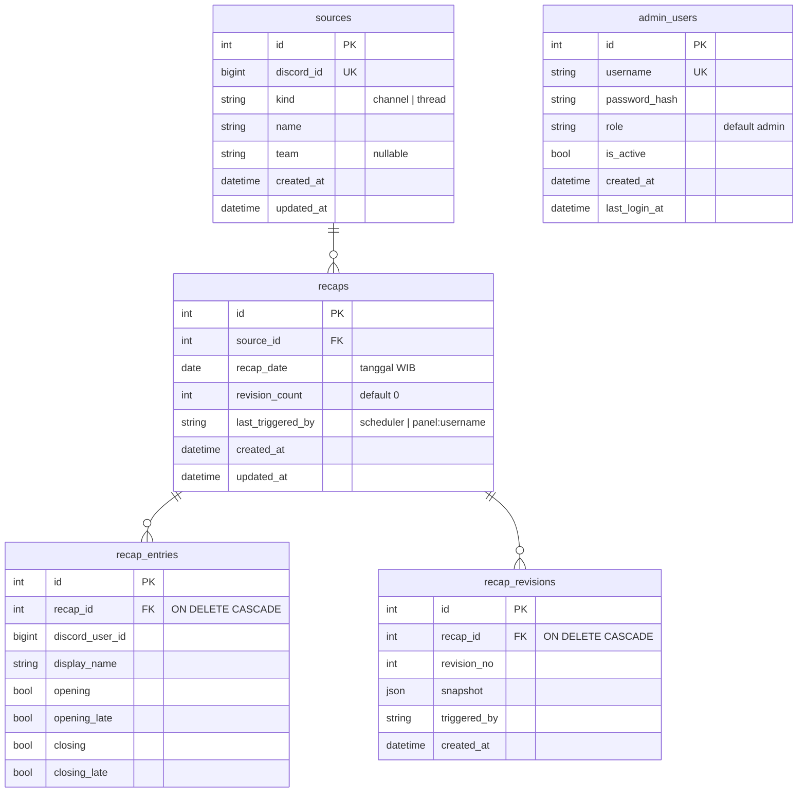

# Progres: Database + Login Admin

Branch: `feature/database-login` (belum di-merge ke `master`)
Terakhir diperbarui: 2026-11-15

## Ringkasan status

| Langkah | Isi | Status | Commit |
|---|---|---|---|
| 0 | Analisis kode, ERD, keputusan desain | ✅ Selesai | — |
| 1 | Config & secrets (`.env`, file example, `.gitignore`) | ✅ Selesai | `2f8c694` |
| 2 | Perbaikan bug tengah malam di scheduler + test | ✅ Selesai | `06fa085` |
| 3 | Layer database: engine, model, migrasi awal Alembic | ✅ Selesai | `951815f` |
| 4 | Service simpan/rewrite + log revisi + cek identik + test | ✅ Selesai | `d2a69f8` |
| 5 | Integrasi ke alur rekap (scheduler & panel) | ✅ Selesai | (belum di-commit) |
| 6 | Login admin (CLI, login/logout, CSRF, rate limit, proteksi route) | ⏳ Berikutnya | — |
| 7 | Halaman riwayat + export Excel dari DB | ⬜ Belum | — |
| 8 | CLI pemetaan source → tim | ⬜ Belum | — |
| 9 | Skrip backup `scripts/backup_db.py` + cara restore | ⬜ Belum | — |
| 10 | Update `bot.http` dan README | ⬜ Belum | — |

PR: #6 (Langkah 1–4 sudah direview).

Test saat ini: **52 passed** (`venv\Scripts\python -m pytest`).

---

## Keputusan desain (final)

1. **Database**: SQLite (WAL, foreign keys ON) lewat SQLAlchemy 2.x, migrasi dengan Alembic. Pindah ke PostgreSQL cukup ganti `DATABASE_URL`.
2. **Unit rekap = (source, tanggal WIB)**. Opening & Closing ada dalam satu baris (4 flag), jadi tidak ada `recap_type`. Kunci: `UNIQUE(source_id, recap_date)`.
3. **Rewrite**: rekap ulang tanggal yang sama menimpa data. Versi lama disimpan ke `recap_revisions`.
4. **Hasil identik**: hanya `updated_at` dan `last_triggered_by` yang diperbarui, tanpa revisi. Dibandingkan per `discord_user_id`, urutan tidak berpengaruh.
5. **Tanggal tanpa pesan** tetap disimpan dengan 0 entries, supaya rekap ulang bisa mengosongkan data.
6. **Tanggal setelah hari ini (WIB)** tidak disimpan ke DB (status `skipped`), tapi Excel tetap dikirim.
7. **Kalau DB gagal**: error di-log, status `error` per tanggal, dan Excel tetap dikirim ke Discord.
8. **Rentang tanggal**: disimpan per tanggal, masing-masing dalam transaksinya sendiri.
9. **`_collect_range`** memakai Discord user id (`uid`) sebagai kunci dict per hari, dengan nama hasil `resolve_name` di field `"name"`. Dua user dengan nama sama tidak lagi tergabung. Filter, flag, dan isi/format Excel tidak berubah (dibuktikan dengan test pembanding terhadap kode lama). *(Diubah dari rencana awal "hanya tambah field uid".)*
10. **`generate_recap`** dipecah menjadi `_collect_range` + `_write_xlsx`. `run_all_recaps` mengembalikan `(results, save_report)`.
11. **Excel ke Discord** tetap dari data live. Export dari DB hanya untuk halaman riwayat.
12. **Panel** hanya di localhost (`WEB_HOST=127.0.0.1`), tanpa nginx/domain/HTTPS. Static dipindah ke `/static/` supaya semua halaman wajib login.
13. **Zona waktu**: tetap `pytz` dan `TZ` dari `config.py`.
14. **Secret** hanya di `.env`. `appsettings.json` dan `user.json` tidak lagi di-track git (repo public).
15. **Backup**: skrip manual, penjadwalan ditunda sampai deploy.
16. Kolom `opening_at` / `closing_at` ditunda.
17. **Perubahan `display_name` saja** (flag sama) tidak dihitung sebagai perubahan: nama diperbarui, status `unchanged` dengan `names_updated: N`, tanpa revisi. Snapshot revisi lama tetap menyimpan nama saat itu.
18. **User yang dihapus dari `user.json`** lalu tanggal lamanya direkap ulang → entri orang itu hilang dari tanggal tersebut. Ini dihitung sebagai perubahan, jadi versi lama tersimpan di revisi.

### ERD



---

## Yang sudah dikerjakan

### Langkah 1 — Config & secrets (`2f8c694`)

- `config.py` membaca `.env` lewat python-dotenv: `DISCORD_TOKEN`, `SECRET_KEY`, `WEB_HOST` (default `127.0.0.1`), `WEB_PORT` (default `8080`), `SESSION_COOKIE_SECURE` (default `false`), `DATABASE_URL`.
- `bot_token` di `appsettings.json` masih dibaca sebagai fallback sementara.
- File config dicari dari folder proyek, bukan dari folder tempat perintah dijalankan.
- `bot.py` berjalan di `WEB_HOST:WEB_PORT` dan berhenti dengan pesan jelas kalau token kosong.
- `appsettings.json` dan `user.json` dikeluarkan dari tracking git (`git rm --cached`). File lokal tetap ada.
- File baru: `.env.example`, `appsettings.example.json`, `user.example.json`.
- `.gitignore` ditambah: `.env`, `appsettings.json`, `user.json`, `*.db*`, `*.sqlite*`, `backups/`.

### Langkah 2 — Bug tengah malam di scheduler (`06fa085`)

- Bug: tanggal rekap diambil dengan `datetime.now(TZ).date()` **setelah** sleep. Kalau bot bangun lewat 00:00, yang direkap adalah hari baru yang masih kosong.
- Perbaikan: tanggal rekap = `target.date()`, dikunci **sebelum** sleep.
- Perhitungan jadwal dipindah ke fungsi `next_recap_target()` supaya bisa dites, dan tetap benar walaupun jam server UTC.
- Loop mengingat tanggal rekap terakhir, jadi tanggal yang sama tidak direkap dua kali.
- Test (`tests/test_scheduler.py`, 11 kasus): 23:58–00:01 WIB, pergantian tahun, jam server UTC, bangun terlambat 61 detik / 2 menit. Sudah dibuktikan bahwa test ini gagal kalau kode lama dipasang lagi.
- Tambahan: `pytest.ini`, `requirements-dev.txt`.
- Belum berubah: kalau bot mati pada pukul 23:59, rekap hari itu tidak dijalankan susulan secara otomatis. Bisa dijalankan ulang dari panel.

### Langkah 3 — Layer database (`951815f`)

- `db/base.py`:
  - satu engine untuk seluruh proses, `session_scope(write=...)` untuk transaksi singkat,
  - SQLite: WAL, `foreign_keys=ON`, `busy_timeout=5000`, `synchronous=NORMAL`, dan `BEGIN IMMEDIATE` untuk transaksi tulis,
  - semua timestamp disimpan dalam UTC (`utcnow()`).
- `db/models.py`: 5 tabel sesuai ERD, ditambah `UNIQUE(recap_id, revision_no)`, index `recap_date`, dan nama constraint yang eksplisit.
- Alembic: `alembic.ini`, `migrations/env.py` (URL dari `DATABASE_URL`, batch mode SQLite), migrasi `0001_initial_schema.py`.
- `admin_users` sudah ikut di migrasi awal. Langkah 6 tidak perlu migrasi baru.
- Test (`tests/test_db.py`, 9 kasus): skema migrasi sama dengan model, pragma aktif, path relatif, UNIQUE, foreign key, `ON DELETE CASCADE`, JSON roundtrip, `BEGIN IMMEDIATE`.
- Sudah dicek juga: `upgrade` → `downgrade` → `upgrade` berjalan bersih, `alembic check` tanpa perbedaan, dan SQL PostgreSQL menghasilkan `BOOLEAN DEFAULT true` + `JSONB`.

### Langkah 4 — Service simpan/rewrite (`d2a69f8`)

- `services/recap_store.py` (sinkron; di Langkah 5 dipanggil lewat `asyncio.to_thread`):
  - `save_recap_day(source, recap_date, entries, triggered_by, today)` — satu transaksi `BEGIN IMMEDIATE`:
    1. upsert `sources` (nama/kind diperbarui kalau berubah),
    2. belum ada → `created`,
    3. flag identik → `unchanged` (hanya nama, `updated_at`, `last_triggered_by` yang diperbarui),
    4. berbeda → snapshot ke `recap_revisions`, ganti entries, `revision_count` naik → `updated`,
    5. tanggal > hari ini (WIB) → `skipped`, tanpa menyentuh DB.
  - `save_recap_range(...)` — per tanggal, transaksi sendiri. Tanggal tanpa data → 0 entries. Error → `error` + `log.exception`, tanggal lain tetap disimpan.
  - `entries_from_day_data()` — konversi hasil `_collect_range` (dengan field `uid`) ke `EntryIn`.
  - `SourceInfo` / `EntryIn` / `DaySaveResult` (punya `to_dict()` untuk response JSON). Service tidak bergantung pada objek discord.py.
  - Snapshot: `{revision_count, triggered_by, updated_at, entries[]}` dari versi lama. `discord_user_id` di snapshot disimpan sebagai **string** (ID Discord > 2^53, aman dibaca JavaScript di panel).
- Perbaikan `migrations/env.py`: `fileConfig(..., disable_existing_loggers=False)`. Sebelumnya, menjalankan migrasi dari dalam proses mematikan logger aplikasi, sehingga log error hilang.
- Test (`tests/test_recap_store.py`, 17 kasus): simpan pertama, rewrite + snapshot, revisi berulang, rekap identik (urutan beda), perubahan nama saja, nama source berubah, tanggal kosong, mengosongkan data lama, tanggal masa depan, hari ini, rentang tanggal (termasuk kosong & masa depan), rentang campuran, error satu tanggal, `uid` wajib, `uid` duplikat, dua penyimpanan bersamaan.
- Sudah dibuktikan: tanpa `BEGIN IMMEDIATE`, test dua penyimpanan bersamaan gagal 4 dari 6 kali; dengan `BEGIN IMMEDIATE` selalu lolos.

### Langkah 5 — Integrasi ke alur rekap (belum di-commit)

- `services/recap.py`:
  - `_collect_range` → `{date: {uid: {"name", "op", "cl", "op_late", "cl_late"}}}`. Logika filter dan flag tidak berubah.
  - `_write_xlsx(source_name, daily, date_from, date_to)` — urut per nama (lalu uid kalau nama sama). Format, kolom, nama file, dan nama sheet sama seperti sebelumnya.
  - `generate_recap()` tetap ada (kumpulkan + tulis xlsx, tanpa DB).
  - `run_all_recaps(client, date_from, date_to, triggered_by="panel")` → `(results, save_report)`. Per source: kumpulkan → simpan ke DB lewat `asyncio.to_thread(save_recap_range, ...)` → tulis xlsx. Semua source tetap paralel.
  - Kalau DB gagal: `log.exception`, status `error` untuk setiap tanggal source itu, dan Excel tetap dibuat dan dikirim.
- `services/recap_store.py`: `entries_from_day_data` mengikuti struktur baru (kunci uid, `name` wajib).
- `services/scheduler.py`: `triggered_by="scheduler"`, ringkasan hasil simpan dicetak ke log.
- `web/server.py`: response `POST /recap` sekarang berisi `"saved"` (lihat contoh di bawah). `triggered_by` sementara `"panel"`, menjadi `"panel:<username>"` di Langkah 6.
- `web/static/script.js`: hasil simpan per tanggal ditampilkan di log panel. `addLog` sekarang meng-escape HTML (nama thread Discord bisa berisi karakter apa saja).
- Data asli (2 Discord ID + nama karyawan) di `tests/test_recap_store.py` diganti dengan data fiktif.
- Test baru:
  - `tests/test_recap_flow.py` (10): kunci uid + field name, dua uid dengan nama sama (dua entry dan dua baris Excel), **Excel identik dengan kode lama** (salinan persis kode `d2a69f8`, dibandingkan sel per sel untuk 1 hari, rentang, tanpa data, dan file all_channel), `run_all_recaps` menyimpan ke DB, rekap ulang → `unchanged`, DB gagal → Excel tetap ada, tanpa source, simpan DB jalan di thread lain (bukan event loop).
  - `tests/test_server_recap.py` (3): response berisi `saved`, tanpa source, validasi tanggal tetap sama.
  - `tests/test_recap_store.py` (+2): `name` wajib, dua uid dengan nama sama disimpan sebagai dua entry.
- Sudah dibuktikan: kalau urutan baris di `_write_xlsx` diubah, 3 test pembanding Excel gagal.

Contoh response `POST /recap`:

```json
{
  "status": "ok",
  "date_from": "2026-11-12",
  "date_to": "2026-11-12",
  "files": ["recap_2026-11-12_channel_a.xlsx", "recap_2026-11-12_all_channel.xlsx"],
  "saved": [
    {
      "source_id": "800000000000000001",
      "source": "channel a",
      "kind": "channel",
      "dates": [
        {"recap_date": "2026-11-12", "status": "updated", "recap_id": 3,
         "revision_no": 1, "names_updated": 0, "error": null}
      ]
    }
  ]
}
```

---

## Yang belum dikerjakan

### Langkah 6 — Login admin (berikutnya)

- Flask-Login, hash password dengan `werkzeug.security`.
- CLI `create-admin` (tidak ada halaman register).
- Halaman login (template Jinja) dan tombol logout. `last_login_at` dicatat.
- CSRF: Flask-WTF `CSRFProtect`. Token diambil dari `GET /api/csrf-token` dan dikirim lewat header `X-CSRFToken`.
- Rate limit login: Flask-Limiter dengan storage memory.
- Semua route terlindungi, termasuk `POST /recap`. API yang belum login mendapat 401 JSON, dan `script.js` mengarahkan ke halaman login.
- Static dipindah ke `/static/`.
- Cookie session: HttpOnly, SameSite=Lax, Secure mengikuti `SESSION_COOKIE_SECURE`.
- Dependency baru: `Flask-Login`, `Flask-WTF`, `Flask-Limiter`.

### Langkah 7 — Halaman riwayat + export

- Filter: tanggal, rentang, source, tim. Tampilkan jumlah revisi dan isi revisi.
- Export Excel dari DB (dibuat di memori, tanpa file sementara), dengan kolom yang sama seperti Excel saat ini.

### Langkah 8 — CLI pemetaan source → tim

- Contoh: `set-team <discord_id> <tim>`, `list-sources`.
- Source yang belum pernah direkap tetap bisa dipetakan: `kind` diambil dari config, nama sementara diperbarui saat rekap berikutnya.

### Langkah 9 — Backup

- `scripts/backup_db.py` memakai backup API SQLite (aman saat DB sedang dipakai).
- Nama file bertimestamp di `backups/`, hapus file yang lebih dari 14 hari.
- Cara restore: hentikan bot, salin file backup, hapus `-wal`/`-shm`, jalankan lagi.

### Langkah 10 — Dokumentasi

- `bot.http`: request login di awal (ambil CSRF token dulu) dan endpoint baru.
- README: setup lokal, isi `.env`, migrasi, buat admin, jalankan bot dan panel, backup dan restore.

---

## Hal yang masih terbuka / perlu tindakan

- [ ] **Reset token bot** di Discord Developer Portal, lalu simpan token baru hanya di `.env` dan hapus `bot_token` dari `appsettings.json`.
- [ ] **Buat `.env`** dari `.env.example` dan isi `SECRET_KEY` (`python -c "import secrets; print(secrets.token_hex(32))"`).
- [ ] **Data asli di riwayat git**: commit `d2a69f8` (sudah di PR #6) berisi 2 Discord ID + nama karyawan asli di `tests/test_recap_store.py`. Sudah diganti di working tree, tapi masih ada di riwayat branch. Putuskan: rewrite riwayat branch sebelum merge, atau terima. `README.md` di `master` juga berisi 1 pasangan ID + nama asli (akan diganti di Langkah 10).
- [ ] **Pemetaan tim** (Produk / Implementor / Development) belum ada. CLI-nya tetap dibuat di Langkah 8.
- [ ] Buka PR ke `master` setelah semua langkah selesai (atau Draft PR lebih dulu). Jangan merge tanpa review.

## Aturan kerja

- Satu langkah dikerjakan lalu berhenti. Lanjut hanya setelah "lanjut".
- **Claude tidak menjalankan `git commit` / `git push`.** Commit dan push dilakukan manual; Claude hanya memberi saran pesan commit.
- Isi `.env`, `appsettings.json`, dan `user.json` tidak pernah ditampilkan atau di-commit.
- Data di test, dokumen, dan contoh selalu **fiktif** (ID dan nama karangan), tidak pernah diambil dari `user.json` atau `appsettings.json`.

## Perintah berguna

```powershell
# install dependency (termasuk pytest)
venv\Scripts\python -m pip install -r requirements-dev.txt

# jalankan semua test
venv\Scripts\python -m pytest -v

# buat / perbarui database lokal
venv\Scripts\alembic upgrade head
venv\Scripts\alembic current
venv\Scripts\alembic check

# jalankan bot + panel (http://127.0.0.1:8080)
venv\Scripts\python bot.py
```
